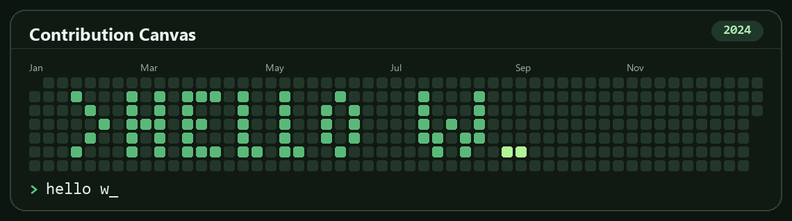

# Contribution Canvas

English · [简体中文](README.zh-CN.md)

Draw pixel art on your GitHub contribution graph. Try the editor without signing in or giving it a GitHub token. Export your design when you're ready to generate the commits locally.

**[Try it online →](https://shaqg.github.io/contribution-canvas/)** · [View the finished 2025 graph](https://github.com/ShaqG?tab=overview&from=2025-12-01&to=2025-12-31)



## Make your first design

1. Click **Load example** to edit the 2024 terminal art, or pick any year from 2008 onward and start with a blank canvas.
2. Paint with the mouse, touch, or keyboard. You can also stamp up to eight English letters, digits, or spaces in one go.
3. **Export JSON** to save or share your design. Import the file to keep editing, or use the generator below to turn it into Git commits.

The editor supports English and Simplified Chinese. For offline use, [download the ZIP](https://github.com/ShaqG/contribution-canvas/archive/refs/heads/main.zip), extract it, and open `index.html`. You can also import the [original HELLO WORLD example](hello-world-2025.json).

Each square represents planned commits. GitHub adds them to existing activity, so the colors on your profile may differ from the preview.

## Generate a local Git repository

Install Python 3.8 or newer and make sure Git is available on your command line. Replace `contributions-YEAR.json` with the exported filename to review the date range and total number of commits.

```shell
python repo_generator.py contributions-YEAR.json --dry-run
```

Choose a new output directory and use an email address associated with your GitHub account.

```shell
python repo_generator.py contributions-YEAR.json --output artwork --name "YOUR_NAME" --email "YOUR_GITHUB_EMAIL"
git -C artwork log --format="%aI %s"
```

The script creates the artwork commits on `main`, with both timestamps set to noon in UTC+08:00 on the selected day. The generated repository identifies its commits as contribution graph art.

## Show the artwork on your GitHub profile

After reviewing the local history, create an empty, standalone GitHub repository such as `contribution-art`. Leave the README, license, and .gitignore options unchecked when creating it, then push your local history.

```shell
git -C artwork remote add origin https://github.com/YOUR_USERNAME/contribution-art.git
git -C artwork push -u origin main
```

Confirm that `main` is the default branch and select the artwork year on your profile. GitHub uses the author date and account email to attribute qualifying commits. [GitHub contribution rules](https://docs.github.com/en/account-and-profile/reference/profile-contributions-reference)

Inspired by [Mechmallow/git_matrix](https://github.com/Mechmallow/git_matrix). Released under the [MIT License](LICENSE).
