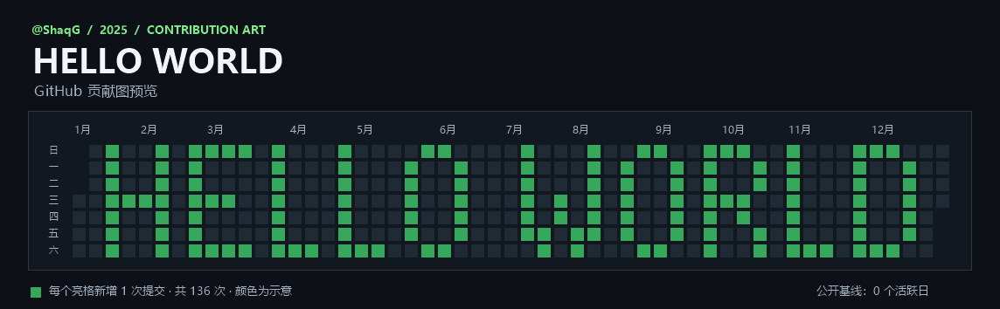

# Contribution Canvas

English · [简体中文](README.zh-CN.md)

Design GitHub contribution graph art in your browser and export a pattern for a standalone Git repository. Download the project and open [index.html](index.html) to use it offline. The editor starts with a blank canvas for the current year, supports years from 2008 onward, and offers English and Simplified Chinese.

1. Pick a brush to set the number of commits per square. Click or drag to paint. On a keyboard, use the arrow keys to select a day and Space to paint.
2. Enter up to eight English letters, digits, or spaces to stamp pixel text. Use the eraser for individual squares or undo the last edit.
3. Export the pattern as JSON. The filename includes the selected year, and you can import it later to continue editing.

Each square represents the commits you plan to add. GitHub combines these with existing activity, so the colors on your profile may differ from the preview.

Download the [HELLO WORLD example](hello-world-2025.json) and import it to try the editor.



## Generate a local Git repository

Install Python 3.8 or newer and make sure Git is available on your command line. Replace `contributions-YEAR.json` with the exported filename to review the date range and total number of commits.

```shell
python repo_generator.py contributions-YEAR.json --dry-run
```

Choose a new output directory and use an email address associated with your GitHub account.

```shell
python repo_generator.py contributions-YEAR.json --output artwork --name "YOUR_NAME" --email "YOUR_GITHUB_EMAIL"
git -C artwork log --format="%aI %s"
```

The script creates the artwork commits on `main`, with both timestamps set to noon in UTC+08:00 on the selected day. The generated repository identifies its commits as contribution graph art.

## Show the artwork on your GitHub profile

After reviewing the local history, create an empty, standalone GitHub repository such as `contribution-art`. Leave the README, license, and .gitignore options unchecked when creating it, then push your local history.

```shell
git -C artwork remote add origin https://github.com/YOUR_USERNAME/contribution-art.git
git -C artwork push -u origin main
```

Confirm that `main` is the default branch and select the artwork year on your profile. GitHub uses the author date and account email to attribute qualifying commits. [GitHub contribution rules](https://docs.github.com/en/account-and-profile/reference/profile-contributions-reference)

Inspired by [Mechmallow/git_matrix](https://github.com/Mechmallow/git_matrix). Released under the [MIT License](LICENSE).
