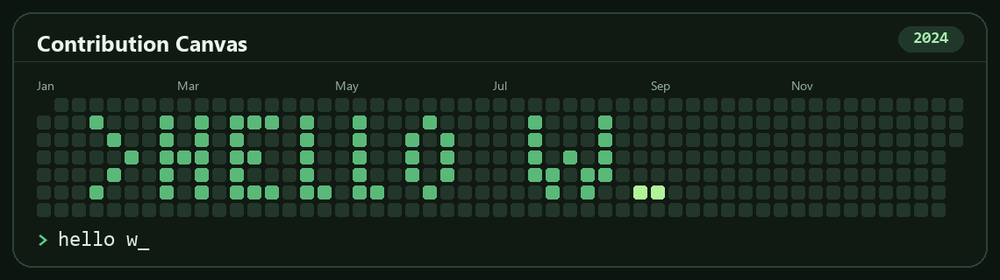

# 贡献图画布

[English](README.md) · 简体中文

在 GitHub 贡献图上画像素画。打开编辑器就能试用，无需登录或提供 GitHub Token。画好后可以导出图案，在本地生成对应的 Git 提交。

**[在线试玩 →](https://shaqg.github.io/contribution-canvas/)** · [查看 2025 年贡献图成品](https://github.com/ShaqG?tab=overview&from=2025-12-01&to=2025-12-31)



## 开始画第一张图

1. 点 **加载示例**，直接编辑 2024 年的终端图案。也可以选一个年份，从空白画布开始画。
2. 用鼠标、触屏或键盘给格子着色，也可以一次绘制最多 8 个英文字母、数字或空格。
3. 点 **导出 JSON** 保存或分享图案。之后可以导入继续编辑，或用下面的生成器创建 Git 提交。

右上角可以切换简体中文和 English。离线使用时，[下载 ZIP](https://github.com/ShaqG/contribution-canvas/archive/refs/heads/main.zip) 并解压，再打开 `index.html`。原来的 [HELLO WORLD 图案](hello-world-2025.json) 也可以继续导入。

每格代表计划新增的提交数。GitHub 会将这些提交与已有活动合并，颜色深浅可能和预览不同。

## 生成本地 Git 仓库

需要 Python 3.8 或更新版本，以及可以通过命令行调用的 Git。把下面的 `contributions-YEAR.json` 换成实际导出的文件名，先查看日期范围和提交总数。

```powershell
python repo_generator.py contributions-YEAR.json --dry-run
```

生成仓库时，选择一个尚不存在的输出目录，并填写 GitHub 账号已关联的邮箱。可以在 GitHub 的邮箱设置中查看用于提交的地址。

```powershell
python repo_generator.py contributions-YEAR.json --output artwork --name "YOUR_NAME" --email "YOUR_GITHUB_EMAIL"
git -C artwork log --format="%aI %s"
```

脚本会在新目录的 `main` 分支生成图案提交。作者和提交时间都设为所选日期的北京时间中午。生成的仓库会注明这些提交用于图案创作。

## 显示在 GitHub 主页

确认本地历史后，可以在 GitHub 建立一个独立空仓库，例如 `contribution-art`。创建时跳过 README、许可证和 `.gitignore`，然后手动推送。

```powershell
git -C artwork remote add origin https://github.com/YOUR_USERNAME/contribution-art.git
git -C artwork push -u origin main
```

确认 GitHub 仓库的默认分支是 `main`，再在个人主页切换到所选年份。GitHub 会根据作者日期和邮箱等条件统计提交。[查看 GitHub 贡献规则](https://docs.github.com/en/account-and-profile/reference/profile-contributions-reference)

设计流程参考 [Mechmallow/git_matrix](https://github.com/Mechmallow/git_matrix)。

本工具采用 [MIT 许可证](LICENSE)。
